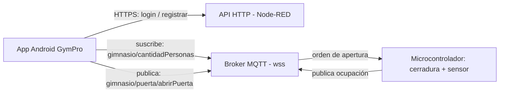

# GymPro

App Android nativa (Java) para un gimnasio. Es el cliente móvil de un sistema
embebido/IoT, desarrollado como trabajo práctico de **Sistemas Operativos Avanzados (SOA)**.

El gimnasio tiene una puerta con cerradura controlada por un microcontrolador y un sensor
que cuenta cuánta gente hay adentro. Ambos hablan por MQTT; un backend en Node-RED expone
una API HTTP para los usuarios.

> **Aviso:** este proyecto fue generado íntegramente con IA (Claude Code) como experimento.

## Arquitectura



Paquetes (`com.soa.gympro`):

| Paquete | Contenido |
|---|---|
| `config` | `Config`: único lugar con URL, broker, topics y aforo |
| `api` | Retrofit (`ApiService`, `ApiClient`), DTOs y `ApiErrorParser` |
| `data` | `SessionManager` (SharedPreferences) y `data/db` (Room: usuarios, ingresos, pagos) |
| `mqtt` | `MqttManager` (conexión única), `OcupacionParser`, `AperturaPayload` |
| `ui` | Activities: login, registro, menú, ocupación, puerta, pagos |
| `util` | `Validaciones` del registro |

## Funcionalidades

- **Login** con DNI y contraseña; la sesión queda guardada y cada ingreso se registra en Room.
- **Registro** con validaciones del lado del cliente.
- **Menú** con saludo, estado de la cuota y estado de la conexión MQTT.
- **Ocupación en tiempo real** con barra y color según el aforo máximo.
- **Abrir la puerta** desde el celular (solo con cuota al día y MQTT conectado).
- **Historial de pagos** desde la base local.

Capturas: _(pendiente)_

| Login | Menú | Ocupación | Puerta | Pagos |
|---|---|---|---|---|
|  |  |  |  |  |

## Topics MQTT

| Topic | Dirección (app) | Payload |
|---|---|---|
| `gimnasio/cantidadPersonas` | Suscribe | `{ "cantidadPersonasActual": 12 }` (`null` o ausente → 0; JSON inválido → se registra el error y se ignora) |
| `gimnasio/puerta/abrirPuerta` | Publica (QoS 1) | `{ "accion": "abrir", "dni": "12345678", "nombre": "Ana", "timestamp": 1732200000000 }` (`timestamp` en ms desde epoch) |

## Endpoints HTTP

Base: `https://soa.alfatechnologies.com.ar/`

| Método y ruta | Request | Respuestas |
|---|---|---|
| `GET /login` | query `dni`, `clave` | `200` `{ "ok": true, "nombre": "...", "estado": true\|false }` · `400/401` `{ "error": "..." }` |
| `POST /registrar` | JSON `{ "dni", "clave", "nombre", "apellido" }` | `200` / `500` `{ "ok": bool, "estado": "..." }` · `400` / `409` (DNI existente) `{ "error": "..." }` |

## Compilar y correr

Requisitos: Android SDK con la plataforma 37 y un JDK 17+ (sirve el JBR de Android Studio).

- **Android Studio**: abrir la carpeta y ejecutar el módulo `app`.
- **Línea de comandos** (el wrapper ya está incluido):

```bash
./gradlew assembleDebug      # APK en app/build/outputs/apk/debug/
./gradlew test               # tests unitarios
```

Si Gradle no encuentra el SDK, crear `local.properties` con `sdk.dir=/ruta/al/Android/Sdk`.

### Configuración

URL de la API, URI del broker, topics y aforo se definen una sola vez en
`app/build.gradle.kts` (`buildConfigField`) y se leen desde `config/Config.java`.

## Probar MQTT con Mosquitto

Contra un broker local (desde el emulador), cambiar `MQTT_BROKER_URI` por una URI alcanzable
por el emulador (el broker debe tener un listener WebSocket, por ejemplo en el puerto 9001)
y redirigir el puerto:

```bash
adb reverse tcp:9001 tcp:9001
```

Simular el sensor de ocupación y ver las órdenes de apertura:

```bash
mosquitto_pub -h localhost -t gimnasio/cantidadPersonas -m '{"cantidadPersonasActual": 23}'
mosquitto_sub -h localhost -t gimnasio/puerta/abrirPuerta -v
```

## Decisiones técnicas

- **Cliente MQTT**: `com.github.hannesa2:paho.mqtt.android` (fork mantenido, vía JitPack).
  La librería original `org.eclipse.paho.android.service` está abandonada y crashea en
  Android 13+ por el `RECEIVER_EXPORTED`. El fork mantiene la API de Paho, soporta `wss://`
  y trae su servicio declarado en el manifest.
- **Una sola conexión** (`MqttManager`): reconexión automática, clientId persistente,
  resuscripción al reconectar, último valor por topic y callbacks en el hilo principal.
  Si falla la conexión inicial se reintenta cada 5 s (Paho solo reconecta solo tras una
  primera conexión exitosa).
- **HTTP**: Retrofit + Gson con timeouts de 15 s y mensajes para falta de red, timeout y
  cuerpos de error JSON.
- **Persistencia**: Room (usuarios, ingresos, pagos) y SharedPreferences para la sesión.
- **Java 17, compileSdk/targetSdk 37**, minSdk 24.

## Limitaciones conocidas

- Los **pagos son simulados**: se cargan datos de ejemplo la primera vez que el socio abre
  el historial. No hay pasarela de pagos.
- El login envía la contraseña como query string (`GET /login?dni=&clave=`), como define
  la API; conviene pasarlo a POST.
- El estado de la cuota se toma del login y no se refresca hasta volver a iniciar sesión.
- Las sesiones no se verificaron en un dispositivo/emulador con el broker real; solo se
  comprobó que compila y que pasan los tests unitarios.
